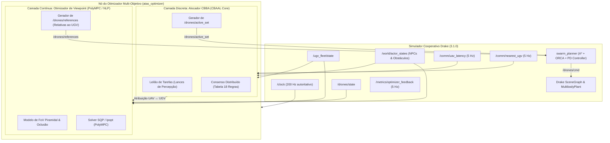

# Arquitetura Alvo do Sistema de Otimização Multi-Objetivo (ATAS MOO)

**Versão da Arquitetura:** 1.0.0  
**Data:** 23 de outubro de 2026  
**Status:** Aprovada para Implementação  
**Escopo:** Módulo Otimizador em Malha Fechada integrado ao Simulador Cooperativo Drake 3.1.0

---

## 1. Visão Arquitetural e Princípios de Separação

O sistema ATAS adota o princípio de **decomposição hierárquica em duas camadas**:
1. **Camada Discreta e Coordenadora (CBBA - Baseada em CBAAL):** Opera em taxa moderada (~1 Hz a 2 Hz), decidindo **quantos** e **quais** UAVs permanecem ativos, além de atribuir a cada UAV a responsabilidade perceptual por um determinado UGV de solo ou região de interesse.
2. **Camada Contínua e Local (Viewpoint NLP - Baseada em PolyMPC):** Opera em taxa rápida (~5 Hz a 10 Hz), calculando as **poses de referência ótimas** $(\Delta x^*, \Delta y^*, z^*, \text{yaw}^*)$ de cada UAV ativo, expressas no referencial do seu UGV atribuído.
3. **Camada de Execução e Controle (Externa - Simulador Drake):** O nó `swarm_planner` do simulador converte a pose relativa em coordenadas mundiais absolutas e executa o planejamento de trajetória livre de colisão ($A^* + \text{ORCA}$) e o controle dinâmico dos motores.

---

## 2. Camada Discreta de Coordenação: CBBA (Baseado no CBAAL)

### 2.1 Mapeamento e Adaptação do `CBAAL`
No projeto [Jakcrimson/CBAAL](https://github.com/Jakcrimson/CBAAL), cada agente possui a classe `CBBA_agent`, encapsulando seu feixe de tarefas ($b_i$), caminho ($p_i$), lances locais ($y_i$), vencedores conhecidos ($z_i$) e marcas temporais ($s_i$).

Para o ATAS, a adaptação opera com as seguintes premissas:
- **Tarefas $J$:** Cada tarefa $j \in J$ corresponde a um robô de solo UGV ativo ou cluster prioritário de atores (NPCs dinâmicos e obstáculos de risco).
- **Capacidade de Atribuição ($L_t = 1$):** Como o otimizador gera apenas a pose de referência estática quasi-estática (e não roteamento de visitação sequencial), cada UAV $i$ assume a cobertura primária de um único UGV ($L_t = 1$).
- **Função de Lance de Percepção ($c_{ij}$):** Em vez da distância euclidiana com decaimento temporal cego, o lance do UAV $i$ pelo UGV $j$ é dado por:
  $$c_{ij} = w_{\text{cobertura}} \cdot \mathcal{Q}_{\text{percepção}}(i, j) - w_{\text{latência}} \cdot \mathcal{L}_{ij} - w_{\text{energia}} \cdot \mathcal{E}_i$$
  onde:
  - $\mathcal{Q}_{\text{percepção}}(i, j)$: estimativa do volume de FoV útil e visibilidade geométrica sobre o UGV $j$ e os NPCs ao seu redor.
  - $\mathcal{L}_{ij}$: latência de comunicação rádio medida ou predita via `/comm/uav_latency`.
  - $\mathcal{E}_i$: custo de ativação do drone $i$ (privilegiando manter menos drones ativos se a cobertura já for satisfatória).
- **Consenso Distribuído:** Executa o algoritmo canônico de 18 regras de resolução de conflito com sincronização assíncrona entre vizinhos via tópicos ROS 2.

---

## 3. Camada Contínua de Viewpoint: NMPC/NLP (Baseado no PolyMPC)

### 3.1 Formulação Matemática do Problema Não Linear (NLP)
Para cada UAV ativo $i$ atribuído ao UGV $k$, o PolyMPC resolve o seguinte programa não linear contínuo:

$$\min_{\Delta x_i, \Delta y_i, z_i, \psi_i} \quad \mathcal{J}(\Delta x_i, \Delta y_i, z_i, \psi_i) = - w_1 \cdot \mathcal{A}_{\text{FoV}}(z_i) \cdot \cos(\theta_i) + w_2 \cdot \text{Penalidade}_{\text{Oclusão}} + w_3 \cdot \mathcal{L}(d_i)$$

**Sujeito às restrições rígidas operacionais:**
1. **Altitude Operacional Permitida:**
   $$2.5\text{ m} \le z_i \le 35.0\text{ m}$$
2. **Raio de Visada e Afastamento em Relação ao UGV:**
   $$\Delta x_i^2 + \Delta y_i^2 \le R_{\text{max}}^2$$
3. **Evasão Mútua Inter-Drones no Plano Horizontal (Anti-Colisão de Viewpoint):**
   $$\|(\mathbf{p}_{i, \text{rel}} + \mathbf{p}_{\text{UGV}}) - (\mathbf{p}_{j, \text{rel}} + \mathbf{p}_{\text{UGV}})\| \ge d_{\text{segurança}}, \quad \forall i \ne j$$
4. **Campo de Visada Óptico (Frustum):**
   $$|\operatorname{atan2}(\Delta x_{\text{alvo}}, z_i)| \le \frac{\alpha_{\text{horiz}}}{2}, \quad |\operatorname{atan2}(\Delta y_{\text{alvo}}, z_i)| \le \frac{\alpha_{\text{vert}}}{2}$$

### 3.2 Integração com o Solver PolyMPC
- A classe de problema deriva de `polympc::nlp_traits` e `polympc::Problem`.
- O solver SQP interno do PolyMPC (ou o backend C++ Ipopt disponibilizado em `src/solvers/ipopt_interface.hpp`) calcula a solução ótima em tempo real ($< 25\text{ ms}$).
- As derivadas paradas são avaliadas de forma analítica ou por diferenciação automática do módulo `autodiff` embutido no PolyMPC, evitando aproximações por diferenças finitas instáveis.

---

## 4. Contrato de Comunicação ROS 2

### 4.1 Tópicos de Saída Publicados pelo Otimizador

| Tópico | Tipo de Mensagem | Frequência | Descrição |
| :--- | :--- | :---: | :--- |
| `/drones/active_set` | `swarm_interfaces/msg/DroneActiveSet` | 1 Hz a 5 Hz | Vetor `uint32[] active_ids` com a lista exata dos IDs dos UAVs em operação. |
| `/drones/references` | `swarm_interfaces/msg/DroneReferenceArray` | 5 Hz | Array contendo uma entrada `DroneReference` por UAV ativo, com `x, y, yaw` relativos ao corpo do UGV (`frame_relative = true`), altitude `z` absoluta e `ugv_id` associado. |

### 4.2 Tópicos de Entrada Assinados pelo Otimizador

| Tópico | Tipo de Mensagem | Papel no Otimizador |
| :--- | :--- | :--- |
| `/clock` | `rosgraph_msgs/msg/Clock` | Relógio do simulador (`use_sim_time:=true`). |
| `/ugv_fleet/state` | `swarm_interfaces/msg/UgvStateArray` | Poses e velocidades dos robôs de solo a serem protegidos. |
| `/drones/state` | `swarm_interfaces/msg/DroneStateArray` | Estados atuais de voo dos UAVs para validação de viabilidade. |
| `/comm/uav_latency` | `swarm_interfaces/msg/UavLinkLatencyArray` | Latência rádio medida de cada UAV ao UGV mais próximo. |
| `/comm/nearest_ugv` | `swarm_interfaces/msg/UavLinkLatencyArray` | Associação de proximidade entre UAVs e UGVs. |
| `/world/actor_states` | `swarm_world_interfaces/msg/ActorStateArray` | Poses de veículos e pedestres NPC e obstáculos fixos. |
| `/metrics/optimizer_feedback`| `swarm_interfaces/msg/OptimizerFeedback`| Realimentação com janelas móveis de 60 s para auto-sintonia de pesos. |

---

## 5. Garantia de Robustez e Tolerância a Falhas

1. **Fallback de Não Convergência:** Caso o solver PolyMPC/Ipopt exceda o orçamento de tempo (deadline de 50 ms), o otimizador mantém a última referência válida recebida sem introduzir transientes bruscos.
2. **Geofencing e Clamping Rígido:** A altitude $z$ é saturada no intervalo $[2.5, 35.0]\text{ m}$ por função de saturação suave (*smooth clamp*), impedindo comandos inválidos que possam desestabilizar o `swarm_planner`.
3. **Consistência de Identificadores:** As referências só são emitidas para drones cujo ID esteja explicitamente listado em `active_ids`.
