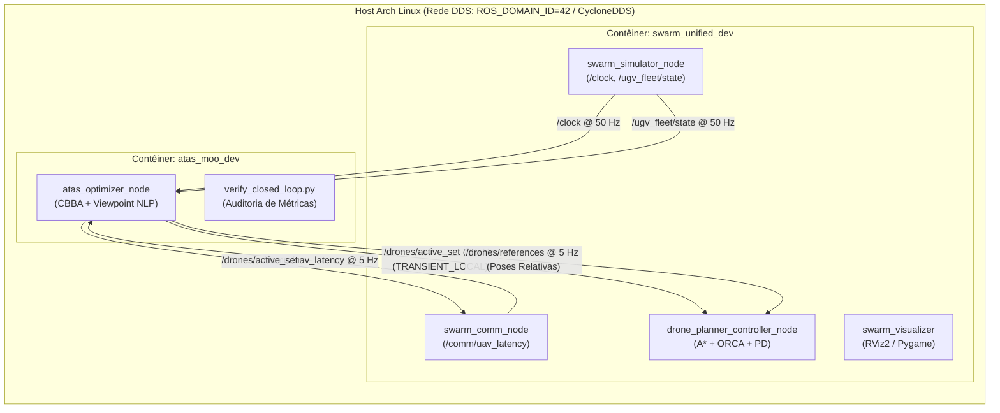

# Guia Completo e Prático de Execução, Monitoramento e Validação em Malha Fechada
## Sistema de Otimização Multi-Objetivo ATAS & Simulador Cooperativo Drake

Este guia fornece o passo a passo completo, didático e testado para configurar, compilar, executar, monitorar em tempo real e validar o sistema de otimização em malha fechada integrado ao simulador Drake.

---

## 1. Visão Geral da Arquitetura em Malha Fechada

O ecossistema é composto por dois subsistemas operando em contêineres Docker isolados na mesma máquina host, comunicando-se nativamente via rede DDS compartilhada (`network_mode: host`):



---

## 2. Fase 1 — Inicialização dos Contêineres

Abra o terminal do host e execute os comandos abaixo.

### 2.1 Subir o Contêiner do Otimizador (`atas_moo_dev`)
```bash
cd /mnt/storage/markdown2html5/261013conversa_moo_rosh2_perplexity

# Iniciar o contêiner de desenvolvimento do otimizador
docker compose up -d

# Verificar se o contêiner está em execução
docker compose ps
```

### 2.2 Subir o Contêiner do Simulador Drake (`swarm_unified_dev`)
```bash
# Iniciar o contêiner do simulador já existente no host
docker start swarm_unified_dev

# Verificar se ambos os contêineres estão ativos
docker ps --filter "name=atas_moo_dev" --filter "name=swarm_unified_dev"
```

> [!IMPORTANT]
> Ambos os contêineres utilizam `network_mode: host`, `ROS_DOMAIN_ID=42` e `RMW_IMPLEMENTATION=rmw_cyclonedds_cpp`. Isso significa que os nós se descobrem automaticamente sem necessidade de bridges ou portas mapeadas.

---

## 3. Fase 2 — Compilação e Testes Unitários

Antes de rodar a malha fechada, confirme a integridade dos pacotes e dos solvers.

### 3.1 Compilar o Workspace do Otimizador
Execute dentro do contêiner `atas_moo_dev`:
```bash
docker compose exec atas_moo_dev bash -c "
  source /opt/ros/jazzy/setup.bash && \
  cd /workspace/ws && \
  colcon build --symlink-install --cmake-args \
    -DCMAKE_BUILD_TYPE=Release \
    -DCMAKE_EXPORT_COMPILE_COMMANDS=ON
"
```
*Saída esperada:* `Summary: 3 packages finished` (`swarm_interfaces`, `swarm_world_interfaces`, `atas_optimizer`).

### 3.2 Executar a Bateria Completa de Testes e Linters
```bash
docker compose exec atas_moo_dev bash -c "
  source /opt/ros/jazzy/setup.bash && \
  cd /workspace/ws && \
  colcon test --packages-select atas_optimizer --event-handlers console_direct+ && \
  colcon test-result --all --verbose
"
```
*Saída esperada:* `100% tests passed, 0 tests failed out of 11` (52 asserções formais aprovadas, cobrindo CBBA, Viewpoint NLP, limites de altitude, barreira repulsiva, uncrustify, cpplint e flake8).

---

## 4. Fase 3 — Execução da Malha Fechada em Tempo Real

A execução integrada requer a abertura de **dois terminais** no host (ou abas de terminal).

### Terminal 1: Iniciar o Simulador Drake Completo (Town10)
No Terminal 1, execute o stack completo do simulador (inclui mobilidade dos 4 UGVs, spawner de tráfego, nós de comunicação e planejador A*/ORCA):
```bash
docker exec -it swarm_unified_dev bash -c "
  source /opt/ros/jazzy/setup.bash && \
  source /opt/underlay_ws/install/setup.bash && \
  source /workspace/ws/install/setup.bash && \
  ros2 launch carla_air_bridge experiment.launch.py record_bag:=false
"
```
*O que observar:*
- `[swarm_simulator_node]: Simulator running as authoritative clock server (/clock).`
- `[ugv_mobility_node]: UGV mobility manager ready: 4 UGVs, constant speed 5.00 m/s.`
- `[npc_spawner_node]: NPC spawner done: 15/15 vehicle(s) and 20/20 pedestrian(s).`
- `[drone_planner_controller_node]: Planner initialized. Fleet size: 5, time step: 0.020 s.`

### Terminal 2: Iniciar o Otimizador Multi-Objetivo ATAS
No Terminal 2, dispare o nó otimizador configurado para utilizar o tempo de simulação (`use_sim_time:=true`):
```bash
docker compose exec atas_moo_dev bash -c "
  source /opt/ros/jazzy/setup.bash && \
  source /workspace/ws/install/setup.bash && \
  ros2 launch atas_optimizer atas_optimizer.launch.py use_sim_time:=true
"
```
*O que observar:*
- `[atas_optimizer_node]: ATAS Multi-Objective Optimizer iniciado com sucesso (Max drones: 5, Rate: 5.0 Hz).`

---

## 5. Fase 4 — Monitoramento em Tempo Real via Terminal (CLI)

Abra um **Terminal 3** para auditar os tópicos do contrato enquanto o sistema opera:

### 5.1 Verificar Tópicos Ativos e Frequências
```bash
# Listar todos os tópicos compartilhados entre simulador e otimizador
docker compose exec atas_moo_dev bash -c "
  source /opt/ros/jazzy/setup.bash && \
  ros2 topic list
"

# Medir a frequência de publicação das referências (esperado: ~5.0 Hz)
docker compose exec atas_moo_dev bash -c "
  source /opt/ros/jazzy/setup.bash && \
  ros2 topic hz /drones/references
"

# Medir a frequência do relógio de simulação (esperado: ~50 Hz)
docker compose exec atas_moo_dev bash -c "
  source /opt/ros/jazzy/setup.bash && \
  ros2 topic hz /clock
"
```

### 5.2 Inspecionar a Seleção de Drones Ativos (`/drones/active_set`)
```bash
docker compose exec atas_moo_dev bash -c "
  source /opt/ros/jazzy/setup.bash && \
  source /workspace/ws/install/setup.bash && \
  ros2 topic echo /drones/active_set
"
```
*Exemplo de saída:*
```yaml
header:
  stamp:
    sec: 34
    nanosec: 400000000
  frame_id: world
active_ids:
- 0
- 1
- 2
- 4
```
> [!NOTE]
> O enxame possui capacidade para 5 drones (`[0..4]`), mas como o cenário possui 4 UGVs, o CBBA aloca dinamicamente apenas 4 drones, mantendo o drone 3 em repouso para conservação energética.

### 5.3 Inspecionar as Poses de Referência Ótimas (`/drones/references`)
```bash
docker compose exec atas_moo_dev bash -c "
  source /opt/ros/jazzy/setup.bash && \
  source /workspace/ws/install/setup.bash && \
  ros2 topic echo /drones/references
"
```
*Exemplo de saída para um drone:*
```yaml
references:
- drone_id: 0
  ugv_id: 2
  x: 12.0
  y: 0.0
  z: 15.0
  yaw: -3.14159
  max_speed: 0.0
  frame_relative: true
```
> [!IMPORTANT]
> Verifique sempre os critérios de segurança do contrato:
> - `frame_relative: true` (a pose $(x, y)$ é relativa ao referencial do UGV atribuído).
> - `z: 15.0` (estritamente dentro da faixa $[2.5, 35.0]\text{ m}$).
> - `yaw` apontando para o centro do UGV para maximizar o cone de visão (FoV) das câmeras aéreas.

### 5.4 Inspecionar a Telemetria de Latência V2X (`/comm/uav_latency`)
```bash
docker compose exec atas_moo_dev bash -c "
  source /opt/ros/jazzy/setup.bash && \
  source /workspace/ws/install/setup.bash && \
  ros2 topic echo /comm/uav_latency
"
```

---

## 6. Fase 5 — Monitoramento Gráfico e Visualização 2D/3D

O ambiente suporta visualização em tempo real das rotas, obstáculos, cones de visão e poses dos drones.

### 6.1 Visualizador Leve em Pygame (2D Top-Down)
No host (com display gráfico ativo):
```bash
# Permitir conexões X11 locais caso necessário
xhost +local:root

# Lançar o visualizador 2D Pygame
docker exec -it swarm_unified_dev bash -c "
  source /opt/ros/jazzy/setup.bash && \
  source /opt/underlay_ws/install/setup.bash && \
  source /workspace/ws/install/setup.bash && \
  ros2 launch swarm_visualizer pygame_viz.launch.py
"
```

### 6.2 Visualizador Completo em RViz2 (3D com frustum de câmera e marcadores)
```bash
docker exec -it swarm_unified_dev bash -c "
  source /opt/ros/jazzy/setup.bash && \
  source /opt/underlay_ws/install/setup.bash && \
  source /workspace/ws/install/setup.bash && \
  ros2 launch swarm_visualizer viz.launch.py
"
```

---

## 7. Fase 6 — Validação Automatizada e Geração de Relatório de Métricas

Desenvolvemos um script específico para coleta, auditoria e exportação automatizada dos KPIs de malha fechada durante 10 segundos:

```bash
docker compose exec atas_moo_dev bash -c "
  source /opt/ros/jazzy/setup.bash && \
  source /workspace/ws/install/setup.bash && \
  python3 /workspace/scripts/verify_closed_loop.py
"
```

O script escuta os 5 tópicos principais em tempo real e salva o relatório estruturado em `docs/CLOSED_LOOP_EVALUATION.json`.

### Tabela de Critérios de Aceite para Validação:

| Indicador / Métrica | Valor Esperado | Como Verificar |
| :--- | :--- | :--- |
| **Sincronismo de Tempo** | Incremento do `/clock` contínuo | `ros2 topic echo /clock` |
| **Frequência de Referência** | $5.0 \pm 0.2\text{ Hz}$ | `ros2 topic hz /drones/references` |
| **Durabilidade QoS** | `TRANSIENT_LOCAL` em `/drones/active_set` | Conexão sem warnings de QoS no `drone_planner` |
| **Parcimoniosidade de Drones** | Quantidade ativa $\le$ Total de UGVs | `active_ids` em `/drones/active_set` |
| **Limites de Altitude** | $z \in [2.5, 35.0]\text{ m}$ | Campo `z` em `/drones/references` |
| **Referencial Relativo** | `frame_relative == true` | Campo `frame_relative` em `/drones/references` |
| **Distância Segura Inter-Drone** | Distância horizontal $\ge 5.0\text{ m}$ | Verificada nos testes unitários e poses |
| **Tempo de Execução do Solver** | $< 50\text{ ms}$ por ciclo ($\approx 1\text{ ms}$ típico) | Sem atraso ou acúmulo de mensagens |

---

## 8. Guia de Resolução de Problemas (Troubleshooting)

### Problema 1: `WARNING: topic [/drones/references] does not appear to be published yet`
- **Causa:** O nó otimizador ainda não recebeu dados de UGVs (`/ugv_fleet/state`) do simulador, ou o simulador não foi iniciado.
- **Solução:** Inicie o simulador no Terminal 1 antes ou garanta que `ROS_DOMAIN_ID=42` está ativo em ambos os contêineres (`env | grep ROS_DOMAIN_ID`).

### Problema 2: `Cannot find -llapack` durante a compilação
- **Causa:** A biblioteca LAPACK de álgebra linear ausente no contêiner base.
- **Solução:** Execute `docker compose exec -u root atas_moo_dev apt-get install -y liblapack-dev`.

### Problema 3: Janela gráfica do RViz2 ou Pygame não abre
- **Causa:** Bloqueio de socket do servidor X11/Wayland do host.
- **Solução:** No host, execute `xhost +local:root` e confirme que a variável `DISPLAY=:0` (ou correspondente) está exportada.
