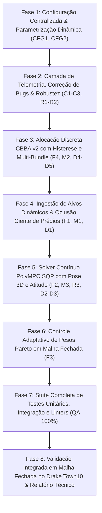

# Plano de Implementação Detalhado — Versão 1.0.0 (v1.0.0)
## Sistema de Otimização Multi-Objetivo ATAS (Autonomy Through Aerial Swarms)

**Status:** Aguardando Aprovação do Usuário  
**Data:** 26 de Outubro de 2026  
**Ambiente:** Ubuntu 24.04 LTS / ROS 2 Jazzy / Drake 1.57.0 / NVIDIA GPU / Domínio DDS 42  

---

## 1. Visão Geral e Alinhamento com as Decisões de Arquitetura

O plano contempla integralmente as definições e decisões aprovadas:
1. **Foco Visual Híbrido:** Rastreamento do UGV e cobertura prioritária de pedestres, veículos NPC e cruzamentos cegos no entorno.
2. **Câmera Solidária ao Chassi (Fixa):** A pose ótima calculada orienta simultaneamente a posição $(x, y, z)$ e a atitude $(\text{yaw}, \text{pitch})$ do UAV para apontar o sensor.
3. **PolyMPC Nativo via C++ e Ipopt:** Formulação NLP com solver SQP estruturado sobre templates Eigen3 e backend Ipopt.
4. **Drones Inativos em Base / Repouso:** Posição fixa de heliponto e silenciamento de emissões.
5. **Histerese Anti-Chattering:** Limiar mínimo de $\Delta J \ge 15\%$ para transferências de tarefas no CBBA.

---

## 2. Detalhamento das Fases de Implementação

### Fase 1: Configuração Centralizada e Parametrização Dinâmica (CFG1, CFG2)
- **Objetivo:** Eliminar parâmetros *hardcoded*, centralizar a configuração em YAML e habilitar reconfiguração em tempo de execução via ROS 2 Parameters.
- **Entregáveis:**
  - `ws/src/atas_optimizer/config/atas_optimizer_params.yaml`:
    - Pesos iniciais Pareto ($w_{\text{det}} = 1.0$, $w_{\text{lat}} = 0.5$, $w_{\text{uav}} = 2.0$).
    - Limites de altitude $[z_{\min}, z_{\max}] = [2.5, 35.0]\text{ m}$.
    - Raio de cobertura máxima $R_{\max} = 30.0\text{ m}$ e raio de proteção inter-drone $d_{\text{safe}} = 5.0\text{ m}$.
    - Histerese CBBA $\Delta J_{\text{hyst}} = 0.15$ (15%) e tamanho máximo de feixe $M_{\text{bundle}} = 2$.
    - Coordenadas dos helipontos/bases de repouso dos drones inativos.
    - Timeouts de watchdog ($500\text{ ms}$) e deadline do solver SQP ($40\text{ ms}$).
  - Implementação de `rclcpp::Node::on_set_parameters_callback` em `AtasOptimizerNode`.
- **Verificação:** Modificar pesos dinamicamente com `ros2 param set` sem necessidade de reiniciar o nó.

---

### Fase 2: Telemetria, Correção de Bugs e Filtros de Robustez (C1, C2, C3, R1, R2)
- **Objetivo:** Conectar a telemetria física real dos drones, corrigir a indexação de latência e blindar o nó contra anomalias numéricas e quedas de comunicação.
- **Entregáveis:**
  - **Correção C1 (Matriz de Latência):** Mapear latências como `std::map<std::pair<uint32_t, uint32_t>, double>` para associar o par `(drone_id, ugv_id)`.
  - **Correção C2 (Ingestão Física `/drones/state`):** Assinar `swarm_interfaces/msg/DroneStateArray` e alimentar as posições reais $\mathbf{p}_i = (x, y, z)$ e velocidades $\mathbf{v}_i$ nos agentes CBBA e no estimador de custo de transição.
  - **Correção C3 (UGVs Inativos):** Tratar `ugv.active == false`, expurgando tarefas de UGVs concluídos ou acidentados.
  - **Robustez R1 (Watchdog & Failsafe):** Timer independente monitorando o recebimento de `/clock` e `/ugv_fleet/state`. Em caso de interrupção $> 500\text{ ms}$, acionar modo `FAILSAFE_HOLD`.
  - **Robustez R2 (Sanity Filter):** Verificação pré-publicação de `std::isnan()` / `std::isinf()` e saturação estrita em $z \in [2.5, 35.0]\text{ m}$ com `frame_relative = true`.
- **Testes Unitários:** Testar injeção de NaNs, perda forçada de mensagens de UGV e expurgo de tarefas de UGV inativo.

---

### Fase 3: Alocação Discreta CBBA v2 — Histerese e Multi-Bundle (F4, M2, D4, D5)
- **Objetivo:** Refinar o protocolo CBBA para suportar múltiplos alvos, histerese anti-chattering, penalidade de contenção de canal e estado de standby em base.
- **Entregáveis:**
  - **Histerese Anti-Chattering:** Adicionar condição de substituição de tarefa no `CbbaAgent`: uma tarefa $j$ só é tomada de outro UGV se $y_{\text{new}} > y_{\text{current}} \cdot (1.0 + \Delta J_{\text{hyst}})$.
  - **Multi-Bundle ($M = 2$):** Permitir que um único drone cubra 2 UGVs próximos em comboio.
  - **Penalidade de Contenção RF:** Adicionar penalidade exponencial por UGV com base na contagem de UAVs no mesmo enlace.
  - **Repouso em Base:** Drones com feixe vazio publicam as coordenadas de sua base de lançamento e não entram em `/drones/active_set`.
- **Testes Unitários:** Simular cenários de transição rápida de UGVs e comprovar a eliminação de *chattering* com histerese de 15%.

---

### Fase 4: Percepção Ativa & Oclusão Ciente dos Edifícios de Town10 (F1, M1, D1)
- **Objetivo:** Integrar os alvos reais (pedestres e veículos NPC) e os 30 prédios poligonais do mapa no cômputo de visibilidade.
- **Entregáveis:**
  - **Carga de Prédios de Town10:** Leitura dos 30 obstáculos poligonais 3D a partir dos dados do `map_service`.
  - **Ingestão de Alvos:** Assinar `/metrics/detection_summary` e `/npc/spawn_summary` para capturar pedestres e veículos no raio de 25 m de cada UGV.
  - **Cálculo de Linha de Visada (LoS Ray Casting):** Penalizar fortemente poses onde o vetor entre o drone e os alvos/UGVs intersecta as caixas delimitadoras dos edifícios.
- **Testes Unitários:** Validar desvio do cone de visão quando um edifício fica entre o drone e o UGV.

---

### Fase 5: Solver Contínuo PolyMPC SQP com Pose 3D e Atitude (F2, M3, R3, D2, D3)
- **Objetivo:** Implementar o otimizador NLP formulado em PolyMPC com resolução SQP, otimizando $(x, y, z, \text{yaw}, \text{pitch})$ para câmera fixa e com limitador de taxa de variação.
- **Entregáveis:**
  - **Formulação NLP em PolyMPC:**
    - Variáveis de decisão: $\mathbf{x} = [\Delta x, \Delta y, z, \psi, \theta]^T$.
    - Função custo: $J = w_{\text{det}} J_{\text{fov}}(\mathbf{x}) + w_{\text{lat}} J_{\text{dist}}(\mathbf{x}) + w_{\text{safe}} J_{\text{barrier}}(\mathbf{x})$.
    - Restrições: $z \in [2.5, 35.0]\text{ m}$, $\sqrt{\Delta x^2 + \Delta y^2} \le R_{\max}$, separação inter-drone $\ge 5.0\text{ m}$.
  - **Câmera Solidária:** Cálculo acoplado do pitch ótimo: $\theta^* = \arctan\left(\frac{z - z_{\text{ugv}}}{\sqrt{\Delta x^2 + \Delta y^2}}\right)$.
  - **Limitador de Slew-Rate (M3):** $\Delta \mathbf{p}_k = \mathbf{p}_{k-1} + \text{clamp}(\mathbf{p}^* - \mathbf{p}_{k-1}, -v_{\max}\Delta t, +v_{\max}\Delta t)$.
  - **Fallback Determinístico (R3):** Timer com interrupção em $40\text{ ms}$; se não convergir, aplicar formação analítica orbital pré-computada.
- **Testes Unitários:** Benchmark de tempo de execução com Ipopt/SQP garantindo convergência em $< 20\text{ ms}$.

---

### Fase 6: Controle Adaptativo de Pesos Pareto em Malha Fechada (F3)
- **Objetivo:** Criar um controlador supervisorio que ajusta dinamicamente a ênfase de otimização com base na janela deslizante de 60s.
- **Entregáveis:**
  - Callback de `/metrics/optimizer_feedback`:
    - Se `latency_mean_60s > 25 ms` $\rightarrow$ Aumentar $w_{\text{lat}}$ em 20% e reduzir altitude para aproximar os drones.
    - Se `detections_mean_60s < target_detections` $\rightarrow$ Aumentar $w_{\text{det}}$ e ordenar elevação de altitude para expandir a pegada visual.
- **Testes de Integração:** Simular degradação sintética de canal e verificar a adaptação automática dos pesos.

---

### Fase 7: Suíte Completa de Testes, QA e Auditoria Estática
- **Objetivo:** Garantir 100% de cobertura, estabilidade e conformidade com os linters oficiais ROS 2.
- **Entregáveis:**
  - `test_cbba_v2.cpp`: Testes de histerese, multi-bundle e contenção.
  - `test_polympc_nlp.cpp`: Testes de convergência do solver SQP e atitude de câmera.
  - `test_v1_integration.py`: Teste launch_test com injeção de alvos NPC e oclusores de prédios.
  - Execução estática obrigatória: `ament_cpplint`, `ament_uncrustify`, `ament_flake8`, `ament_pep257`, `ament_copyright`, `ament_xmllint`.
- **Critério de Sucesso:** 100% de testes aprovados, zero erros nos linters.

---

### Fase 8: Validação em Malha Fechada no Simulador Drake Town10 & Relatório
- **Objetivo:** Rodar o sistema completo no cenário Town10 em malha fechada real com o Drake e documentar os resultados.
- **Entregáveis:**
  - Execução integrada com `carla_air_bridge experiment.launch.py` durante mais de 60 segundos.
  - Coleta automatizada com `scripts/verify_closed_loop.py`.
  - Elaboração do relatório técnico definitivo em `docs/RELATORIO_V1.md`.

---

## 3. Matriz de Entregáveis e Cronograma Sequencial

| Fase | Descrição | Principais Arquivos Modificados / Criados |
| :---: | :--- | :--- |
| **Fase 1** | Configuração Centralizada & Parâmetros | `config/atas_optimizer_params.yaml`, `atas_optimizer_node.cpp` |
| **Fase 2** | Telemetria Real, Correções C1-C3 & Robustez | `atas_optimizer_node.cpp`, `cbba_agent.cpp`, `DroneStateArray` |
| **Fase 3** | CBBA v2 (Histerese 15%, Multi-Bundle $M=2$) | `cbba_agent.hpp`, `cbba_agent.cpp`, `test_cbba_v2.cpp` |
| **Fase 4** | Ingestão de Alvos & Oclusão de Prédios | `viewpoint_optimizer.cpp`, `DetectionSummary.msg`, `map_service` |
| **Fase 5** | PolyMPC SQP C++ (Pose 3D, Pitch & Slew-Rate) | `viewpoint_optimizer.cpp`, `repos/polympc`, `test_polympc_nlp.cpp` |
| **Fase 6** | Supervisão Adaptativa Pareto (Feedback 60s) | `atas_optimizer_node.cpp` |
| **Fase 7** | Suíte de Testes & QA Linters | `CMakeLists.txt`, `colcon test`, `launch_testing` |
| **Fase 8** | Simulação Real Town10 & Relatório Técnico | `verify_closed_loop.py`, `docs/RELATORIO_V1.md` |
