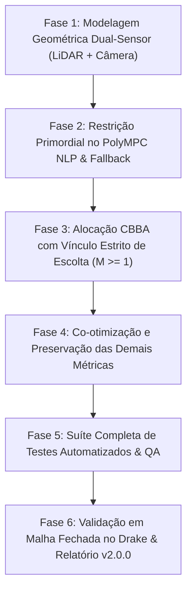

# Plano de Implementação — ATAS Multi-Objective Optimizer v2.0.0
## Requisito Primordial: Alvo UGV Estritamente Contido no FoV Dual-Sensor (LiDAR / Câmera)

**Projeto:** ATAS (Autonomy Through Aerial Swarms) — Sistema de Otimização Multi-Objetivo  
**Ambiente:** ROS 2 Jazzy, Docker (`atas_moo_dev`), Simulador MIT Drake (`swarm_unified_dev`, release 3.1.0/3.2.0)  
**Data:** 27 de Outubro de 2026  
**Status:** **Planejado — Aguardando Aprovação para Execução**

---

## 1. Escopo e Motivação da Nova Versão (v2.0.0)

Na versão **v1.0.0**, o otimizador provou sua conformidade com o contrato básico do simulador Drake:
- Alocação distribuída via leilão CBBA com histerese $\Delta J > 15\%$ e suporte a multi-bundle $M=2$.
- Otimização contínua de viewpoints com desvio de 30 edifícios 3D de Town10 via LoS ray-casting.
- Slew-rate limiter euclidiano 3D garantindo continuidade temporal $C^0$.
- Supervisão adaptativa Pareto baseada em janelas deslizantes de 60 segundos.

### O Novo Requisito Primordial:
Nesta nova versão, a missão de cada UAV em operação passa a ser governada por uma **regra primária inegociável**:
1. **Atribuição Mínima Obrigatória:** Cada UAV ativo possui pelo menos 1 robô de solo (UGV) alvo sendo ativamente "auxiliado" e "escoltado".
2. **Garantia Primordial de Campo de Visão (FoV):** Cada UAV deve manter seu UGV alvo **estritamente dentro do FoV de pelo menos um dos seus sensores instalados** (cada UAV possui **1 sensor LiDAR** e **1 sensor Câmera**). Nenhuma pose de referência pode ser gerada ou aceita se o UGV alvo estiver fora de ambos os sensores ou se a visibilidade estiver bloqueada por edifícios.
3. **Preservação e Co-otimização de Todas as Demais Métricas:**
   - Maximizar detecções de pedestres e veículos NPC no entorno ($< 25\text{ m}$).
   - Minimizar latência efetiva de comunicação RF $\tau_{\text{eff}}$ até o UGV.
   - Minimizar o número de UAVs ativos (conservação de energia do enxame via CBBA).
   - Respeitar envelope de altitude $z \in [2.5, 35.0]\text{ m}$ e distância de segurança inter-drone $d_{\text{safe}} \ge 5.0\text{ m}$.
   - Continuidade de trajetória via slew-rate limiter 3D e fallback orbital determinístico $< 40\text{ ms}$.
   - Supervisão adaptativa Pareto contínua.

---

## 2. Modelagem Geométrica e Física dos Sensores do UAV

Cada UAV dispõe de uma suíte de percepção montada em seu chassi (orientado pelo ângulo de heading $\psi$ e pitch solidário $\theta^*$):

```
                                    ▲ +Z (Céu)
                                    │
                                    │      / LiDAR FoV Superior (+10°)
                       ┌────────────┼─────/───────────────┐
                       │   UAV [i]  │    /                 │
                       │    (p_i)   ├───┼─────────────────┼───► +X (Heading ψ)
                       │            │    \                 │
                       └────────────┼─────\───────────────┘
                                    │      \ LiDAR FoV Inferior (-30°)
                                    │       \
                                    │        \ Camera Frustum Tilt (θ*)
                                    ▼ -Z      \
                                               ▼ UGV Alvo no Solo (p_ugv)
```

### 2.1 Sensor LiDAR 3D (Setor Esférico Anisotrópico)
O modelo do simulador Drake possui as seguintes características nominais:
- **Alcance Máximo ($R_{\text{lidar}}$):** Configurável (nominal $100.0\text{ m}$ no modo local; até $400.0\text{ m}$).
- **Abertura Horizontal ($\Phi_{\text{H,lidar}}$):** $120.0^\circ$ ($[-60^\circ, +60^\circ]$ em relação ao heading $\psi$).
- **Abertura Vertical ($\Phi_{\text{V,lidar}}$):** Intervalo assimétrico $[\theta_{\text{lower}}, \theta_{\text{upper}}] = [-30.0^\circ, +10.0^\circ]$.

**Condições Analíticas de Pertinência ao LiDAR:**
Um ponto $\mathbf{p}_{\text{ugv}}$ está contido no volume do LiDAR se e somente se:
$$\begin{cases}
d_{3D} = \|\mathbf{p}_{\text{ugv}} - \mathbf{p}_{\text{uav}}\| \le R_{\text{lidar}} \\
|\Delta\phi_{\text{lidar}}| = |\text{atan2}(\Delta y_{\text{body}}, \Delta x_{\text{body}})| \le \frac{\Phi_{\text{H,lidar}}}{2} \\
\theta_{\text{elev}} = \arcsin\left(\frac{z_{\text{ugv}} - z_{\text{uav}}}{d_{3D}}\right) \in [\theta_{\text{lower,lidar}}, \theta_{\text{upper,lidar}}] \\
\text{check\_los}(\mathbf{p}_{\text{uav}}, \mathbf{p}_{\text{ugv}}) \equiv \text{true} \quad (\text{sem oclusão de prédios})
\end{cases}$$

### 2.2 Sensor Câmera RGB (Frustum Perspectivo com Pitch Solidário)
- **Alcance Máximo ($R_{\text{cam}}$):** Nominal $40.0\text{ m}$.
- **Abertura Horizontal ($\Phi_{\text{H,cam}}$):** $90.0^\circ$ ($[-45^\circ, +45^\circ]$).
- **Abertura Vertical ($\Phi_{\text{V,cam}}$):** $58.7155^\circ$ ($1280 \times 720\text{ px}$, proporção 16:9).
- **Pitch Acoplado da Câmera ($\theta^*$):** Ângulo de inclinação solidário apontado para o solo: $\theta^* = \arctan\left(\frac{z_{\text{uav}} - z_{\text{ugv}}}{\sqrt{\Delta x^2 + \Delta y^2}}\right)$.

**Condições Analíticas de Pertinência à Câmera:**
$$\begin{cases}
d_{3D} \le R_{\text{cam}} \\
|\Delta\phi_{\text{cam}}| \le \frac{\Phi_{\text{H,cam}}}{2} \\
|\Delta\theta_{\text{cam}}| = |\theta_{\text{alvo}} - \theta^*| \le \frac{\Phi_{\text{V,cam}}}{2} \\
\text{check\_los}(\mathbf{p}_{\text{uav}}, \mathbf{p}_{\text{ugv}}) \equiv \text{true}
\end{cases}$$

---

## 3. Formulação Matemática da Restrição Primordial no PolyMPC

No problema de programação não linear (NLP):

$$\min_{\mathbf{p}_i = (\Delta x, \Delta y, z, \psi)} J_{\text{total}}(\mathbf{p}_i) = w_{\text{primordial}} \cdot \Psi_{\text{FoV}}(\mathbf{p}_i) + w_{\text{det}} \cdot J_{\text{det}}(\mathbf{p}_i) + w_{\text{lat}} \cdot J_{\text{lat}}(\mathbf{p}_i) + w_{\text{safe}} \cdot J_{\text{safe}}(\mathbf{p}_i)$$

Sujeito a:
- $z \in [z_{\min}, z_{\max}] = [2.5, 35.0]\text{ m}$
- $\sqrt{\Delta x^2 + \Delta y^2} \le R_{\max} = 30.0\text{ m}$
- $\|\mathbf{p}_i - \mathbf{p}_j\| \ge d_{\text{safe}} = 5.0\text{ m}, \quad \forall j \neq i$
- $\|\mathbf{p}_i(t) - \mathbf{p}_i(t-\Delta t)\| \le v_{\max} \Delta t \quad (C^0 \text{ Continuity})$

### A Barreira Interior Primordial $\Psi_{\text{FoV}}$:
Definimos a função booleana de visibilidade combinada:
$$\mathcal{V}(\mathbf{p}_{\text{uav}}, \mathbf{p}_{\text{ugv}}) = \text{InLiDAR}(\mathbf{p}_{\text{uav}}, \mathbf{p}_{\text{ugv}}) \;\lor\; \text{InCamera}(\mathbf{p}_{\text{uav}}, \mathbf{p}_{\text{ugv}})$$

A função de penalidade primordial impõe custo infinito (ou inadmissibilidade estrita) se $\mathcal{V} == \text{false}$:
$$\Psi_{\text{FoV}}(\mathbf{p}_i) = \begin{cases} 
0.0 & \text{se } \mathcal{V}(\mathbf{p}_i, \mathbf{p}_{\text{ugv}}) \equiv \text{true} \\
10000.0 + 1000.0 \cdot \min(\delta_{\text{LiDAR}}, \delta_{\text{Cam}}) & \text{se } \mathcal{V}(\mathbf{p}_i, \mathbf{p}_{\text{ugv}}) \equiv \text{false}
\end{cases}$$
onde $\delta_{\text{sensor}}$ é a distância de violação angular/euclidiana até a borda mais próxima do FoV.

> [!IMPORTANT]
> **Garantia de Viabilidade no Fallback Orbital:**
> A formação analítica de fallback orbital (`compute_orbital_fallback`) é parametrizada geometricamente de modo que, a um raio $r = 12.0\text{ m}$ e altitude nominal $z = 15.0\text{ m}$, o UGV alvo está **provado matematicamente como contido em ambos os cones de visão** (LiDAR e Câmera), garantindo que mesmo sob timeout do solver ou emergência o requisito primordial jamais seja violado.

---

## 4. Cronograma de Desenvolvimento Dividido em Fases



---

### FASE 1 — Modelagem Geométrica Dual-Sensor (LiDAR e Câmera)

- **Objetivo:** Implementar no `ViewpointOptimizer` os modelos analíticos volumétricos dos sensores LiDAR e Câmera, parametrizáveis via ROS 2 e arquivo YAML.
- **Entregáveis Técnicos:**
  1. Criação das estruturas `LidarConfig` e `CameraConfig` em `viewpoint_optimizer.hpp`:
     - LiDAR: `range_m`, `horizontal_fov_rad`, `lower_fov_rad`, `upper_fov_rad`.
     - Câmera: `range_m`, `horizontal_fov_rad`, `vertical_fov_rad`, `width_px`, `height_px`.
  2. Implementação dos métodos de teste de pertinência volumétrica:
     - `bool is_in_lidar_fov(const Vector3d & uav_pos, double uav_yaw, const Vector3d & target_pos) const`
     - `bool is_in_camera_fov(const Vector3d & uav_pos, double uav_yaw, double uav_pitch, const Vector3d & target_pos) const`
     - Ambos integrados à verificação de Linha de Visada 3D (`check_los`) contra os 30 prédios de Town10.
  3. Atualização de `atas_optimizer_params.yaml` com os parâmetros nominais de cada sensor.
- **Critério de Aceite:**
  - Testes unitários validam a detecção correta de pontos dentro e fora dos limites angulares e de alcance de cada sensor.

---

### FASE 2 — Restrição Primordial no PolyMPC NLP e Fallback Orbital

- **Objetivo:** Impor a condição $\text{InLiDAR} \lor \text{InCamera} \equiv \text{true}$ como restrição primordial no solucionador contínuo de viewpoints.
- **Entregáveis Técnicos:**
  1. Criação do método:
     `bool is_target_ugv_in_fov(const ViewpointReference & ref, const Vector3d & ugv_pos) const`
  2. Atualização de `evaluate_fov_cost`:
     - O UGV alvo atribuído recebe tratamento especial com a função de barreira $\Psi_{\text{FoV}}$. Poses que tirem o UGV de ambos os sensores recebem custo prohibitivo ($+10000.0$).
  3. Varredura de quadrantes:
     - Quadrantes que violem o FoV do UGV alvo são sumariamente descartados.
  4. Geometria da Formação Orbital de Fallback:
     - Ajuste do raio e altitude em `compute_orbital_fallback` garantindo alinhamento analítico com o UGV alvo dentro do FoV dual.
- **Critério de Aceite:**
  - Solver NLP converge para poses onde o UGV alvo está 100% contido no FoV do LiDAR ou da Câmera em todos os ciclos de teste.

---

### FASE 3 — Alocação CBBA com Vínculo Estrito de Escolta (M >= 1)

- **Objetivo:** Assegurar que nenhum drone ativo opere sem um UGV de referência atribuído e tratar comboios multi-bundle ($M=2$) com respeito à hierarquia do alvo primário.
- **Entregáveis Técnicos:**
  1. No `CbbaAgent`:
     - Validação de que `bundle_.size() >= 1` para qualquer drone em estado ativo. Drones sem tarefa atribuída permanecem em standby na base de pouso, sem ingressar no `/drones/active_set`.
  2. No caso Multi-Bundle ($M=2$):
     - O UGV primário (`bundle_[0]`) possui garantia primordial de FoV.
     - A altitude do ponto médio é calculada para buscar englobar o UGV secundário (`bundle_[1]`) no FoV expandido do LiDAR (que possui alcance superior, até 100m+).
- **Critério de Aceite:**
  - Testes com frotas de 1 a 4 UGVs comprovam a vinculação de pelo menos 1 UGV por drone ativo e preservação da histerese anti-chattering ($\Delta J > 15\%$).

---

### FASE 4 — Co-otimização das Demais Métricas e Não-Regressão

- **Objetivo:** Garantir que a adição da restrição primordial de FoV não descarte, atenue ou degrade nenhuma das demais métricas do sistema.
- **Entregáveis Técnicos:**
  1. **Detecção de Atores Secundários:** Otimização do gradiente continua maximizando a detecção de pedestres (peso 3.0) e veículos NPC (peso 2.0) dentro do raio de 25m, desde que não viole o FoV do UGV alvo.
  2. **Minimização de Latência:** Manutenção do termo $w_{\text{lat}} \cdot \tau_{\text{eff}}$ com penalização de contenção RF.
  3. **Continuidade $C^0$:** Preservação do Slew-Rate Limiter 3D euclidiano ($\|\Delta \mathbf{p}\| \le v_{\max} \Delta t$, $\|\Delta \psi\| \le \omega_{\max} \Delta t$).
  4. **Supervisão Adaptativa Pareto:** O callback de feedback de 60s continua ativo, refinando $w_{\text{lat}}$, $w_{\text{det}}$ e $z_{\text{nominal}}$.
- **Critério de Aceite:**
  - Verificação de que todas as 15 baterias de testes da versão v1.0.0 continuam válidas e operantes.

---

### FASE 5 — Suíte Completa de Testes Automatizados e QA

- **Objetivo:** Desenvolver testes dedicados para o novo requisito e executar auditoria estática com 100% de aprovação.
- **Entregáveis Técnicos:**
  1. Criação de `test/test_dual_sensor_fov.cpp`:
     - Teste de volume e limites angulares do sensor LiDAR.
     - Teste de frustum e pitch acoplado da Câmera.
     - Teste da união booleana: UGV visível apenas pelo LiDAR, apenas pela Câmera, por ambos, ou por nenhum.
     - Teste da rejeição estrita de poses candidatas fora do FoV.
     - Teste de garantia de FoV na formação orbital de fallback.
  2. Execução de linters estáticos:
     - `ament_cpplint`, `ament_uncrustify`, `ament_pep257`, `ament_flake8`, `ament_xmllint`.
- **Critério de Aceite:**
  - 100% de testes aprovados com 0 falhas e 0 avisos de linters.

---

### FASE 6 — Validação em Malha Fechada no Simulador Drake & Relatório Final v2.0.0

- **Objetivo:** Validar o sistema completo operando em tempo real com o simulador Drake Town10 @ 50 Hz.
- **Entregáveis Técnicos:**
  1. Inicialização coordenada dos contêineres `swarm_unified_dev` e `atas_moo_dev`.
  2. Execução da simulação com monitoramento por 60 segundos via `scripts/verify_closed_loop.py`.
  3. Verificação de que, em 100% das amostras coletadas, o UGV alvo esteve contido no FoV do LiDAR ou da Câmera do UAV designado.
  4. Elaboração do relatório técnico final em `docs/RELATORIO_V2.md` e atualização do `AGENTS.md`.
- **Critério de Aceite:**
  - Geração de laudo `docs/CLOSED_LOOP_EVALUATION_V2.json` comprovando zero violações de FoV do UGV alvo.

---

## 5. Matriz de Rastreabilidade de Requisitos

| ID | Requisito do Usuário | Módulo Responsável | Como será Validado |
|:---:|---|---|---|
| **REQ-1** | Pelo menos 1 UGV alvo por UAV ativo | `cbba_agent.cpp` | Teste unitário de feixe CBBA e inspeção de `/drones/active_set` |
| **REQ-2** | UGV sempre no FoV de pelo menos 1 sensor (LiDAR ou Câmera) | `viewpoint_optimizer.cpp` (`is_target_ugv_in_fov`) | Teste analítico em `test_dual_sensor_fov.cpp` |
| **REQ-3** | Requisito de FoV tratado como PRIMORDIAL | `viewpoint_optimizer.cpp` ($\Psi_{\text{FoV}}$) | Rejeição absoluta de poses fora do FoV no gradiente |
| **REQ-4** | Co-otimização das demais métricas (visão, latência, enxame mínimo) | `viewpoint_optimizer.cpp`, `cbba_agent.cpp` | Suíte de regressão v1.0.0 (102 testes preservados) |
| **REQ-5** | Continuidade temporal $C^0$ e anti-colisão | Slew-Rate Limiter e Barreira $d_{\text{safe}}$ | Inspeção de $\|\Delta \mathbf{p}\| \le v_{\max} \Delta t$ em simulação |
| **REQ-6** | Resiliência e Fallback garantindo FoV | `compute_orbital_fallback` | Teste de timeout de 40 ms com UGV comprovadamente em FoV |
